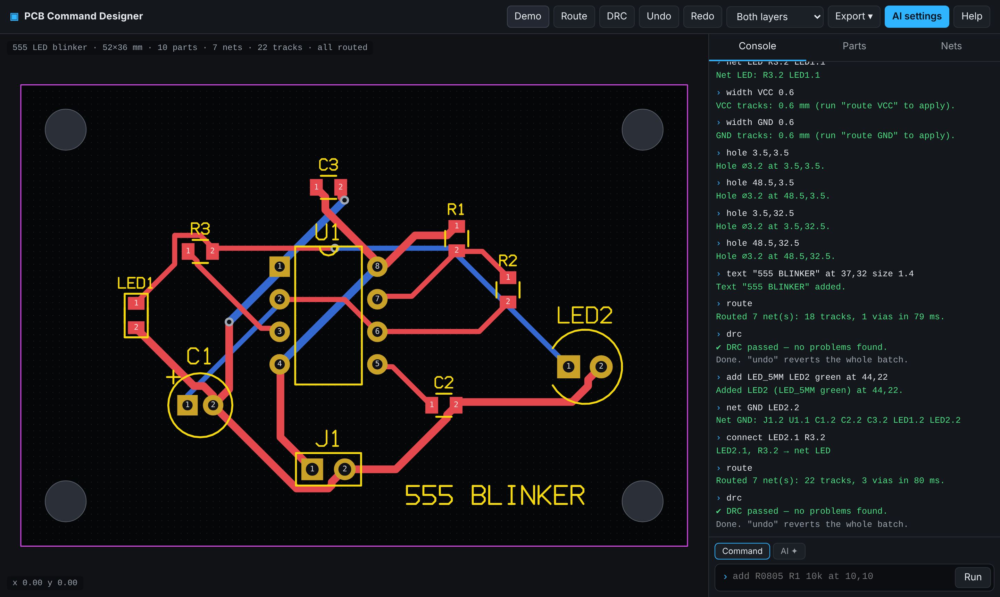
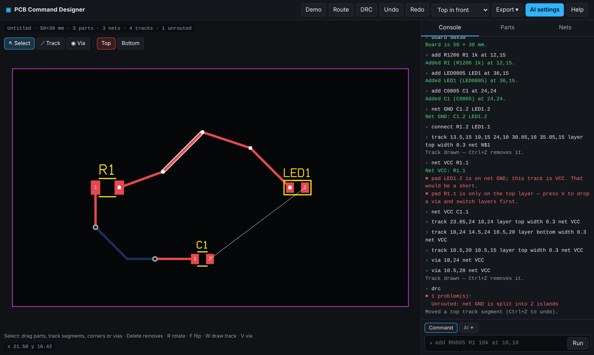

# PCB Command Designer

A browser PCB layout tool in the spirit of EasyEDA, but driven by **typed commands**, with an optional **AI mode** that turns plain language (English, বাংলা or Banglish) into those commands.





## Run it

It is a static site with no build step and no dependencies. ES modules need to be served over HTTP:

```bash
cd pcb-designer
python3 -m http.server 8000
```

Then open http://localhost:8000. On GitHub Pages it works as-is at `/pcb-designer/`.

## Example session

```
board 60x40
add R0805 R1 330 at 15,20
add LED0805 LED1 red at 25,20
add HDR1X2 J1 5V at 10,32
net VCC J1.1 R1.1
net GND J1.2 LED1.2
connect R1.2 LED1.1
width VCC 0.6
route
drc
export gerber
```

Type `demo` for a complete 555 LED blinker, `help` for every command and `footprints` for the parts library.

| Area | Commands |
|---|---|
| Board | `board 80x50`, `grid 1.27`, `rules clearance 0.2 width 0.3 via 0.7/0.35`, `hole 3.5,3.5`, `text "LABEL" at X,Y` |
| Parts | `add <footprint> [REF] [value] [at X,Y] [rot 90] [bottom]`, `move`, `rotate`, `flip`, `value`, `delete`, `autoplace` |
| Nets | `connect R1.2 LED1.1`, `net GND U1.4 C1.2`, `disconnect`, `rename`, `width NET 0.6` |
| Routing | `route [NET]`, `unroute [NET]`, `track R1.2 20,10 LED1.1 [bottom] [width 0.5]`, `via X,Y`, `erase X,Y [top\|bottom]`, `drc` |
| Files | `export gerber\|svg\|png\|bom\|json`, `save`, `load`, `open` |
| AI | `ai <what you want>`, or switch the input to **AI ✦** mode |

You can put several commands on one line with `;`.

## Editing by hand (mouse / touch)

Commands and the mouse work on the same design, so you can autoroute and then fix single tracks by hand. The tool palette above the board has:

| Tool | How it works |
|---|---|
| **Select** (S) | Drag parts, track segments or vias. Click a track to show its corner handles, then drag them. Delete removes the selected part, segment or via. R rotates, F flips. |
| **Track** (W) | Click a pad to start, click to add 45° corners, click the target pad to finish (or double-click, right-click, Enter, or the ✓ Finish button). V drops a via and switches layer. `/` changes the bend style. Backspace removes the last corner and Esc cancels. The preview turns orange when it is too close to other copper. A wrong-net pad or a pad on the other layer is refused. Drawing between two pads also connects them in the netlist. |
| **Via** (V) | Click to place a via. Placed on a track, it joins that track's net. |
| **Top / Bottom** (L) | Choose which copper layer you draw on. |

Every hand edit is one undo step (Ctrl+Z / Ctrl+Y). Track drawings are written to the console as the equivalent `track` / `via` / `connect` commands, so they can be replayed. Drag empty space or right/middle-drag to pan; use the wheel to zoom.

## What's inside

- **Footprints:** 0402–1206 chips, SOD123, SOT23, TO92, TO220, DO41, axial, LED 3/5 mm, radial and disc caps, HC49 crystal, 6 mm tact switch, DIPn, SOICn, 1×N / 2×N headers, screw terminals.
- **Autorouter:** two-layer grid A* with via and turn costs. It retries in a different order when a net fails and keeps manual tracks.
- **DRC:** checks copper clearance, shorts, unrouted nets, parts outside the board, overlapping parts and edge clearance.
- **Fabrication output:** a Gerber RS-274X zip (copper, mask, silkscreen with vector text, outline) plus Excellon PTH/NPTH drill files, ready for JLCPCB/PCBWay-style fabs. Check the files in a Gerber viewer before ordering.
- **AI mode:** sends your request and a summary of the current board to the Claude API (`claude-opus-5-5` by default) and runs the commands it returns as one undoable batch. It uses your own Anthropic API key, which goes straight from your browser to the API. The key is kept in memory, or in `localStorage` only if you tick "remember".

## Files

```
index.html          UI shell
css/style.css       theme
js/main.js          UI wiring, console, panels, dialogs
js/tools.js         mouse editing: select/drag, track drawing, vias
js/commands.js      command language + demo script
js/state.js         design model, undo/redo, world geometry
js/footprints.js    footprint library and pin conventions
js/router.js        autorouter
js/drc.js           connectivity, ratsnest, DRC
js/render.js        canvas renderer
js/export.js        Gerber, Excellon, zip, SVG, BOM
js/font.js          stroke font for silkscreen
js/ai.js            Claude API bridge
```
